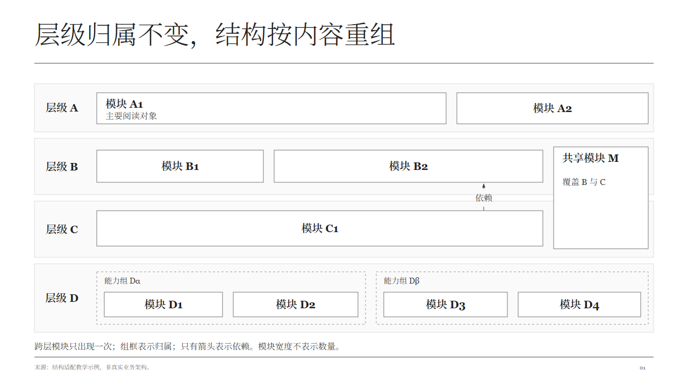

# Jeffy Design

**先把内容讲明白，再选择怎样呈现。**

Jeffy Design 是一个演示设计 Skill，配有素材规范、主题、参考代码和 HTML 工具。模型先理解受众与问题、研究内容，再选择图形并按场景设计页面，最后配逐字稿和验收。



素材提供**必须遵守的语义和绘制规则**，样张与代码提供参考。层数、数量、分组、跨层关系和排布由实际内容决定；可以直接复用、局部修改或依规范重绘。

## 使用入口

- [SKILL.md](SKILL.md)：完整工作流程。
- [Catalog](assets/index.html)：按用途和形态找素材，先读每项规范。
- [Theme](themes/索引.md)：主题配置，字体、字号、配色、间距等以配置为准。
- [素材使用与维护](references/素材使用与维护.md)：适配与新增登记规则。
- [页面组装](references/页面组装.md)：现有工具接口、反馈与验收范围。

下载仓库后可本地打开 HTML。GitHub 的 HTML 链接显示源码，不是在线预览。作为 Skill 安装时需要完整目录，不能只复制 SKILL.md。

## 工作流程

用途与受众 → 主题与核心问题 → 提纲 → 研究与内容 → 呈现方式 → 素材规范与适配 → 绘制组装 → 逐字稿 → 验收 → 交付。

需要用户判断时，最多一次在聊天中提供整稿方案：用途、总页数、每页标题、内容与构造。收到修改后连续制作，不逐页确认，也不弹出 HTML、表单或确认服务；用户要求直接做时不增加确认步骤。

选中素材后，模型说明继承哪些规则、本次结构有什么不同、为什么这样画，再选择实现方式。方法页画清关系，案例页落到具体对象与证据；验收同时检查表达是否成立和规范是否遵守，无碰撞、无越界不代表讲清楚。

## 安装与运行

需要 Node.js 18+、npm、Python 3。以下命令在本项目目录运行：

```bash
git clone https://github.com/jeffy-Peng/jeffy-skills.git
cd jeffy-skills/jeffy-design
npm ci
npx playwright install chromium
npm run example:pressure
npm run verify:pressure
```

打开 `build/pressure/index.html` 查看生成页与讲稿。Linux 如缺浏览器系统依赖，可用 `npx playwright install --with-deps chromium`；也可用 `CHROME_PATH` 指定已有浏览器。正常运行不要求 DSH。

新输入可参考 [pressure.json](tests/composition/pressure.json)，构建和检查：

```bash
node scripts/build-composition.mjs your-deck.json build/custom/index.html
node scripts/verify-page.mjs build/custom/index.html build/custom/validation.json
```

| 实现入口 | 用途 |
| --- | --- |
| `build-composition.mjs` | 多组件分区，12项常规适配器支持主题驱动的静态组装 |
| `build-page.mjs` | 柱线同绘图区，共同坐标、单位与图例 |
| `build.mjs` | 保留的早期模块入口，不是新页面的固定模板 |
| 依规范自定义绘制 | 原生成器不适合时保留语义与样式，重新设计结构 |

## 当前内容与边界

Catalog 有31项表达规范，其中5项保留草稿状态。区域组装有12项常规适配和3项草稿试接；同绘图区支持柱图与折线。具体范围从目录和适配器登记读取，不以独立素材入库推定任意组合已通过。

- 内置主要交付 HTML，尚无统一的原生可编辑 PPTX 导出保证。
- 区域组装12项已迁移统一主题绘制层，验证 `mono`、`klein-blue`、`rounded-mono`；全库31项独立源件、同绘图区和动效尚未全部迁移。
- 生成器不负责任意拓扑重排或自动分页，也不自动继承原素材全部交互与动效。
- 中文字体未打包。黑白灰主题使用 Noto Serif SC 与 Georgia；新主题路径缺字体会明确返回 FONT，需安装后重新生成。
- 自动检查不能判断所有语义与解释效果，仍需实际读图。已完成案例属于同一执行模型的适配和自审，不是独立盲测。

主题配置 → 实际字体加载 → 角色测量 → 布局计算 → 绘制与遮线 → 验收。新增主题维护一个 JSON，不复制素材；新素材使用同一绘制接口。见[主题自适应](references/主题自适应.md)和[三主题对照](examples/theme-adaptation/index.md)。

## 案例

| 案例 | 检查重点 |
| --- | --- |
| [经营、机制与方案选择](examples/pressure/index.html) | 多组件组装与证据对应 |
| [柱图、时间与层级](examples/extended/index.html) | 常见参数和组装容量 |
| [分层结构重绘](examples/layer-adaptation/index.html) | 跨层实体、层内分组、不等宽模块 |
| [跨素材结构适配](examples/cross-material-adaptation/index.html) | 多判断流程、长标签分组柱图、超时与条件重试 |
| [机制素材审核稿](drafts/机制表达审核/index.html) | 泳道、分层和时序的新方案，尚未正式入库 |

案例保留输入、适配理由、讲稿、截图或检查记录，不作为下一页必须沿用的布局。

## 验证与维护

```bash
npm test
npm run test:composition
npm run test:adapters
npm run test:themes
python scripts/test-catalog-contract.py
npm run catalog
```

基础模块检查、12项组装回归、23项素材适配检查，以及规范资源登记检查分别运行；失败返回非零退出码。生成输出和测试报告默认放在忽略的 `build/` 中。

额外的结构案例检查：`python scripts/test-layer-adaptation.py`、`python scripts/test-cross-material-adaptation.py`、`python scripts/test-mechanism-drafts.py`。这些 Python 脚本还需要 Python Playwright 和本机 Edge，目前按 Windows 环境验证。

目录的唯一维护源是 [catalog.json](assets/catalog.json)。每项填写规范、样张设计理由、参考源件、状态与验证边界，再运行 `npm run catalog`。缺失规范资源或理由会报错；规范齐备不会自动提升入库状态。共用透明遮线见 [line-labels.js](assets/共用/line-labels.js)，不要只在个别样页修补。

## 目录结构

```text
SKILL.md       工作流程
assets/        素材规范、样张、参考代码与 Catalog
themes/        主题配置
references/    使用、维护和工具细则
lib/           组装与绘制工具
scripts/       构建与验证
tests/         可复现输入
examples/      页面案例与证据
drafts/        审核稿和历史试稿
```

`contract.json`、`deck.schema.json`、`library.json` 用于早期入口，不是所有新页面的统一限制。历史草稿可能保留旧主题颜色。

本目录随父仓库采用 [MIT License](../LICENSE)。
