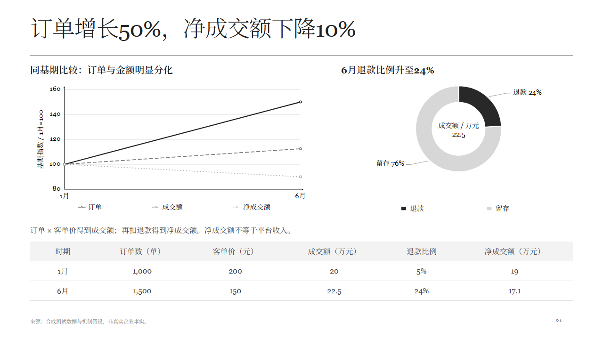

# Jeffy Design

**先把内容想清楚，再决定怎样呈现。**

Jeffy Design 是一套面向 AI 协作的演示设计 Skill、可生成素材库和 HTML 制作工具。它把内容研究、表达选择、主题、素材和验收连接起来，目标是做出信息充分、可独立阅读的页面。

它的工作方式是：先知道这一页要回答什么，再选择图表、关系图、流程或文字，最后按内容组装。素材提供一致的绘制标准，不规定整页必须长什么样。



> 当前主要交付 HTML。以上为合成数据测试页，不代表真实企业经营结果。

## 核心思路

1. **明确用途与受众**：材料给谁看，希望读者理解什么或做什么决定。
2. **确定整稿问题与结构**：拆解问题，研究材料，形成各页内容与标题。
3. **先写明白，再画出来**：每页先有完整解释和必要证据，再选择呈现方式。
4. **选择主题与素材**：主题统一视觉，素材提供可参数化的表达标准。
5. **组装并配逐字稿**：页面展示关键关系，讲稿补充背景、解释与边界。
6. **分层验收**：内容成立、组件正确、整页可读、表达完整分别检查。

### 主题、素材与组装各管什么

| 层 | 职责 |
| --- | --- |
| Skill | 研究内容、决定表达、选择素材、组织阅读顺序、验收 |
| Theme | 字体、字号、颜色、线宽、间距、页眉页脚 |
| Material | 图形含义、输入要求、数据编码与局部绘制 |
| Composition | 目标区域、文字空间、图例、跨组件对应与容量反馈 |

横向、纵向、类别数量、系列数量以及数值或百分比模式，尽量使用同一组件的参数生成，不穷举成大量近似模板。

## 当前能做什么

- **30个目录条目**：包括4份明确标注的未入库草稿。
- **31个独立预览方案**：部分组件有多个方案或历史入口。
- **12个素材 ID 接入区域组装**：黑白灰、静态 HTML，固定1280×720画布。
- **2个素材 ID 接入同绘图区引擎**：柱图与折线图可共享类别、坐标体系和图例。
- 输出同源逐字稿、浏览器截图，以及可追溯的验证报告。

区域组装当前支持：

```text
BAR-001  单系列柱      BAR-002  分组柱       BAR-003  堆叠柱
BAR-006  瀑布图        LINE-001 折线图       PIE-001  饼图 / 环形图
TABLE-001 明细表       TABLE-002 比较矩阵    TIME-001 时间线
REL-001  层级结构      REL-006  多方关系     FLOW-001 流程图
```

`REL-001` 当前接入的是 `root/children` 方案；同条目下另一款简洁线条方案尚未迁移。目录中的独立素材状态、组合能力和验证证据分别维护，不以“已入库”推定“任意组合都通过”。

## 快速开始

需要 Node.js 18+、npm 和 Python 3。以下命令在仓库根目录运行。

```bash
git clone https://github.com/jeffy-Peng/jeffy-skills.git
cd jeffy-skills/jeffy-design
npm ci
npx playwright install chromium
```

如 Linux 提示缺少浏览器系统依赖，可使用 `npx playwright install --with-deps chromium`。浏览器默认读取 Playwright 安装位置；也可用 `CHROME_PATH` 指向已有 Chromium / Chrome。项目保留可选的 DSH 环境兼容路径，但正常安装不要求 DSH。

生成两组三页示例，并验证：

```bash
npm run example:pressure
npm run verify:pressure
npm run example:extended
npm run verify:extended
```

在浏览器中打开：

- `build/pressure/index.html`：经营背离、业务机制、硬约束方案选择。
- `build/extended/index.html`：分组与堆叠、瀑布图、时间线与层级结构。

每页下方可展开逐字稿和自动验收状态。页面旁同时生成 `.notes.md`；`build/` 中的文件不提交到仓库。

不运行构建，也可下载仓库后直接打开 [素材目录](assets/index.html)、[主题目录](themes/索引.md) 与 [预生成示例](examples/pressure/index.html)。GitHub 的 HTML 文件链接显示源码，预览需在本地浏览器打开。

中文排版使用主题指定字体。黑白灰主题为 Noto Serif SC 与 Georgia；字体文件未打包，缺字体时浏览器会回退。正式交付前应安装对应字体并重新检查排版。

## 三个制作入口

| 任务 | 入口 | 说明 |
| --- | --- | --- |
| 多组件分区组装 | `scripts/build-composition.mjs` | 当前主要验证路径，保留主题字号并返回容量和布局问题 |
| 柱线同绘图区 | `scripts/build-page.mjs` | 柱线共享坐标、单位约束及图例；与分区组装的支持范围不同 |
| 早期模块 / 版式构建 | `scripts/build.mjs` | 保留历史兼容，不作为所有新页面的固定模板 |

一个可复现的组装输入见 [pressure.json](tests/composition/pressure.json) 和 [extended.json](tests/composition/extended.json)。自定义构建：

```bash
node scripts/build-composition.mjs your-deck.json build/custom/index.html
node scripts/verify-page.mjs build/custom/index.html build/custom/validation.json
```

每页声明问题、观点、组件任务、阅读顺序、来源与讲稿；组件提供 `material`、`data`、`options` 和目标 `box`。详细字段及反馈见 [页面组装与四关验收](references/页面组装.md)。

## 素材库怎么维护

[Catalog](assets/index.html) 使用一张表，按一级用途、二级形态查找。多款方案挂在同一组件下，旧编号作为别名，不重复计数。

唯一目录数据源为 [assets/catalog.json](assets/catalog.json)。修改后运行：

```bash
npm run catalog
```

它会重建 HTML 与 Markdown 入口，并核对预览、源件、验证记录和脚本引用。组合能力从 [区域适配器登记](lib/composition/adapters.json) 与 [同绘图区登记](lib/page-engine/catalog.json) 派生，不手工填写一个可能过期的“已支持”。

新增素材时：

- 先检查现有组件参数能否覆盖，避免重复劳动。
- 明确适用问题、最低输入、图形含义与误读边界。
- 基准素材用黑白灰，方向、数量和模式由参数驱动。
- 用实际数据变化检查比例、标签、图例、容量与边界。
- 经过审核再入库；草稿保留在 `drafts/`。

流程与关系素材共用 [line-labels.js](assets/共用/line-labels.js)：按最终文字边界生成透明遮线断口，初始绘制、动画帧和组装调整字号后重算。表头、正文与数字的居中由表格生成器维护，不能只修某张样页。

## 验证

```bash
npm test
npm run test:composition
npm run test:adapters
```

- `npm test`：早期模块组合的基础检查。
- `test:composition`：12项检查，包含原三页、错误输入、容量、布局、绑定、实际字号、表格对齐与动态遮线边界。
- `test:adapters`：23项检查，包含新增组件的横纵模式、堆叠原值 / 百分比、零总量、负终点、日期和层级异常。

命令失败返回非零退出码。浏览器测试报告写入 `build/reports/`；图内字号通过实际样式与 SVG 变换矩阵计算，不仅检查源文件里的 `font-size`。

自动检查不能判断所有内容是否讲清楚。最终仍须隐藏讲稿，检查读者能否复述观点、指出证据并追清关键关系。测试通过不代表所有输入、字体、主题或图形组合都已覆盖。

## 项目结构

```text
jeffy-design/
├── SKILL.md                 AI 协作工作流入口
├── assets/                  素材、共用绘制机制与 Catalog
│   ├── catalog.json         目录维护源
│   └── index.html           生成的可查阅目录
├── themes/                  主题参数与主题目录
├── lib/
│   ├── composition/         区域组装适配器与运行时
│   └── page-engine/         同绘图区引擎
├── scripts/                 构建、目录维护、截图与验证
├── tests/composition/       可复现输入和已存验证范围
├── examples/                可本地打开的示例与截图
├── references/              组装、表达与验收规范
├── drafts/                  未入库及历史试稿
└── icons/                   早期图标资源
```

`contract.json`、`deck.schema.json`、`library.json` 及部分早期脚本用于历史入口；新区域组装输入以 `references/页面组装.md` 为准。历史草稿可能保留旧主题颜色，不代表当前黑白灰素材标准。

作为 AI Skill 使用时，应安装完整目录并命名为 `jeffy-design`，入口为 `SKILL.md`；只复制这一文件无法获得素材、主题和工具。

## 当前边界

- 主要交付 HTML，尚无统一的原生可编辑 PPTX 导出保证。
- 区域组装目前只验证 `mono` 黑白灰主题；其他主题配置存在，不代表都通过新引擎验收。
- 当前适配采用固定文字尺寸与几何适配，遇到容量不足会返回原因；不是任意拓扑重排或自动分页求解器。
- 原素材交互、动效与静态成页分别验证，组合页不自动继承所有控件和动画。
- 跨组件一致性只检查显式声明的绑定，未声明的单位、别名及语义仍需审查。
- 本目录随父仓库使用 MIT 许可证，见 [LICENSE](../LICENSE)。

---

**Jeffy Design — 从内容出发，用合适的图形把事情讲清楚。**
