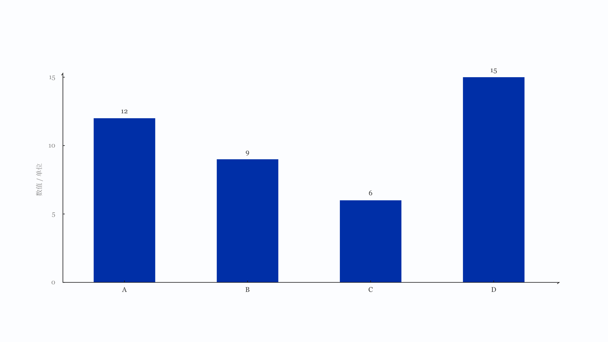

# BAR-001 单系列比较

## 数据形状与分级

数据形状是「多个对象各一个值」。分级主力，提纲时优先选它；只有在它承载不了诚实编码时才换后备，并写明理由。

## 语义

回答各类别在同一个指标上谁多谁少。每个类别一个值，值之间可以直接比较。负数允许，零允许，单条数据允许。类别不只一个时不排序也能读，排序只是辅助。

不能这样用。不要拿它表达占比，那需要百分比构成。不要拿它表达同一类别下的多组数值，那需要分组比较。不要用它暗示时间趋势，横轴不是时间。

## 绘制

竖直方向时柱从零基线向上，类别名在轴下方；水平方向时从零基线向右，类别名在左侧。坐标轴范围从零起，刻度间隔由最大值自动推算，轴上端取刻度的整数倍。

值标签放在柱末端外侧，不带单位。单位只在轴的标注处出现一次，形如「门店数 / 家」。单系列不画图例。

柱宽取槽位的比例，默认一半，可用 `options.widthRatio` 覆盖（0.2 到 0.8）。夹取范围是主题的 `minBarPx` 到槽位的八成，没有固定像素上限。低于 `minBarPx` 时报告容量不足并建议分页，不缩小字号硬塞。

## 可调整

方向可换竖排或横排。排序可按给定顺序、值降序、值升序。类别数量、柱子粗细、间距由数据与可用区域决定，不需要手调。

## 不适用规则

百分比口径不适用，这条素材没有分母。图例相关规则不适用，单系列不出现图例。堆叠与并置不适用，那是分组比较。

## 验收

契约用例五组：基础四类、单条、十二条、超长类别名、缺失值。前三组要求通过，超长标签允许报容量不足，缺失值必须报数据不合法。

## 示意图

`npm run specimen BAR-001` 重新生成，稿子放在 build 目录，只留 PNG 在这里。示意图只画素材本身，不含标题、页码、来源，占位类别用 A 到 D。
