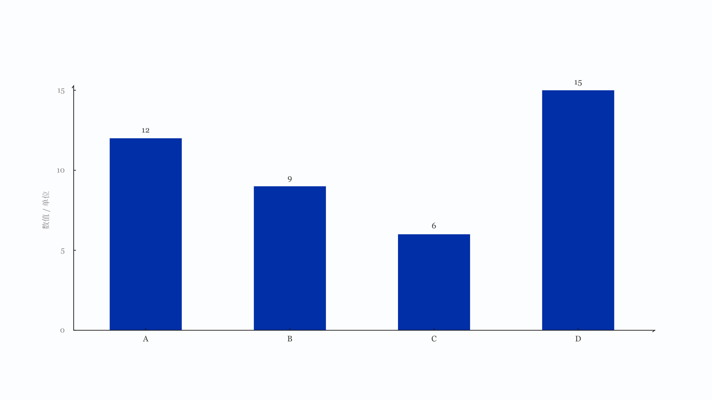

# BAR-001 单系列比较

## 数据形状与分级

数据形状是「多个对象各一个值」。分级主力，提纲时优先选它；只有在它承载不了诚实编码时才换后备，并写明理由。

## 语义

回答各类别在同一个指标上谁多谁少。每个类别一个值，值之间可以直接比较。本条用于非负数；含负数时选 BAR-005。零与单条数据允许。类别不只一个时不排序也能读，排序只是辅助。

不能这样用。不要拿它表达占比，那需要百分比构成。不要拿它表达同一类别下的多组数值，那需要分组比较。不要用它暗示时间趋势，横轴不是时间。

## 绘制

竖直方向时柱从零基线向上，类别名在轴下方；水平方向时从零基线向右，类别名在左侧。坐标轴范围从零起，刻度间隔由最大值自动推算，轴上端取刻度的整数倍。

值标签放在柱末端外侧，不带单位。单位只在轴的标注处出现一次，形如「门店数 / 家」。单系列不画图例。

柱宽取槽位的比例，默认一半，可用 `options.widthRatio` 覆盖（0.2 到 0.8）。夹取范围是主题的 `minBarPx` 到槽位的八成，没有固定像素上限。低于 `minBarPx` 时报告容量不足并建议分页，不缩小字号硬塞。

## 画法随主题

柱有两种非默认画法，由主题的 `materials.barStyle` 或组件的 `kind` 指定：

胶囊柱 `capsule`：柱端圆角等于细边的一半，用于纸灰、无轴一类风格。

刻度柱 `rung`：柱内按单位画横线，一格代表多少单位由数值决定，最多二十四格，超过就按二、五、十、二十合并，并在图左下角写明「一格 = N 单位」。刻度柱只用于小量级，读者要能数出来。

## 随机分节形态 rhythm

2026-11-17 用户确认采用随机长短分节；作为本素材的形态，不新增 ID，不替换原实心画法。调用 `options.kind: "rhythm"`，搭配现有 `direction`、`sort`、`widthRatio`；主题也可用 `materials.barStyle: "rhythm"` 选择。当前参考实现仅覆盖 BAR-001，其他柱族明确返回 UNSUPPORTED。

整体沿数值轴的长度表示值，分节在垂直于数值轴方向高低随机、沿中线居中；分节高低、面积不表达第二指标。使用固定、与类别和数值无关的序列，同一索引在各对象、重绘和方向转换中一致；不能每次刷新随机改变。

零点、范围与坐标沿用共享数值映射。按绘图区长度自动计算节距和节数，不固定四类或 43 节；不足一节的末段按真实长度绘制，首末端严格对应零点和数值，不取整数据。零值无可见分节，仍保留类别及 0 标签；小数与不同数量自动重算。分节只作为纹理，不能宣称“一节恒等于 2 单位”；只有另行固定单位步长并验收后才可标注计数含义。

默认搭配共享轴绘制器的刻尺轴：仅保留数值轴，不画类别轴、箭头与网格；主次刻度间距按范围和像素空间计算，刻度标签与单位使用主题角色。横向为底部刻尺，纵向为左侧刻尺。主题明确指定无轴时沿用无轴。基准黑白灰；主题控制字体、颜色、线宽与间距，不把试稿朱红或底色写死。

分节、透明命中区同属一个交互组，数值标签跟随聚焦；随机高低不得超出槽位，不得遮住轴和邻行。容量不足返回 CAPACITY，不压缩主题字号或丢对象。保留原稿，不把样张坐标作为模型绘制限制。

## 可调整

方向可换竖排或横排。排序可按给定顺序、值降序、值升序。类别数量、柱子粗细、间距由数据与可用区域决定，不需要手调。

## 不适用规则

百分比口径不适用，这条素材没有分母。图例相关规则不适用，单系列不出现图例。堆叠与并置不适用，那是分组比较。

## 验收

契约用例五组：基础四类、单条、十二条、超长类别名、缺失值。前三组要求通过，超长标签允许报容量不足，缺失值必须报数据不合法。

## 示意图

`npm run specimen BAR-001` 重新生成，稿子放在 build 目录，只留 PNG 在这里。示意图只画素材本身，不含标题、页码、来源，占位类别用 A 到 D。

## 随机分节验收记录

[黑白灰交互样张](specimens/BAR-001-rhythm.html) · [静态图](specimens/BAR-001-rhythm.png) · [行为证据](specimens/BAR-001-rhythm.validation.json)。运行 `node scripts/test-rhythm.mjs` 重建样张并验证横纵方向、六类、全零、小数、大跨度、稳定序列、准确端点、槽位边界、标签关联、主题字体与颜色，以及非法数据、负数、容量与未支持柱族。HTML 交互另运行通用真实事件检查。记录仅证明这些输入，不宣称任意布局均可容纳。
