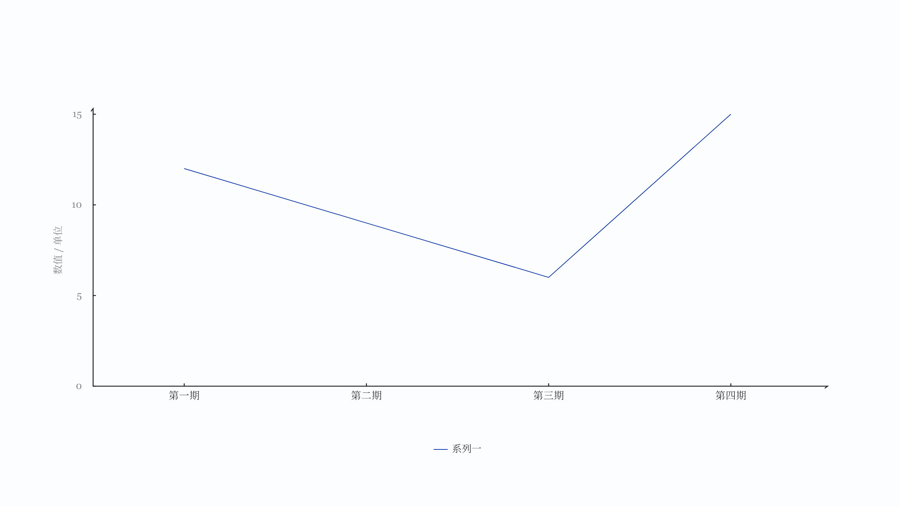

# LINE-001 时间趋势

## 数据形状与分级

数据形状是「带时间的序列」。分级主力，提纲时优先选它；只有在它承载不了诚实编码时才换后备，并写明理由。

## 语义

回答同一指标随时间怎样变化。点代表观测，连线代表有序变化；阶梯表示区间内保持不变。缺失就是缺失，不能当零；累计要求各项可相加，指数要求基期非零。

不能这样用。不要拿它比较不同对象的多少，那需要单系列或分组比较。不要用它表达占比构成。横轴若不是时间，等距只是视觉选择，须在来源或说明里写清口径。

## 绘制

横轴按给定的时期顺序排，等距或真实时间间距由数据口径决定。纵轴从零起，累计与指数模式按变换后的值定范围。多系列时用图例区分，位置在底部居中。

线型由 `options.mode` 决定：`line` 普通折线，`step` 阶梯。面积填充由 `area` 开启，只在单系列时使用。终点可加标注，标注不加单位。单位只在轴的标注处出现一次，形如「金额 / 万元」。

## 可调整

单系列或多系列、普通或阶梯、是否填面积、累计或指数、重点与终点标注都可换。时期数量、点距、线宽由数据与可用区域决定，不需要手调。

## 不适用规则

百分比构成不适用，这条素材没有分母。非时间横轴要显式说明，否则默认按时间口径读。类别数量上限 24 点，超出报容量并建议抽样或分页。

## 验收

契约用例：单系列、三系列、含缺失值、不等距时期、阶梯模式。单系列与三系列要求通过；缺失值必须保留断点而不是补零；不等距时期要按真实位置落点。

## 示意图

`npm run specimen LINE-001` 重新生成，中间稿放在 build 目录，只留 PNG 在这里。示意图只画素材本身，不含标题、页码、来源。

## 样张与参考

[统一组件](../archive/折线图组件/LINE-001.html)。样张里的数量、间距、宽高不是继承要求，布局由本次内容决定。

参考实现 [line.js](../archive/折线图组件/line.js)，只代表已实现能力，不代表这条素材的全部合法结构。
