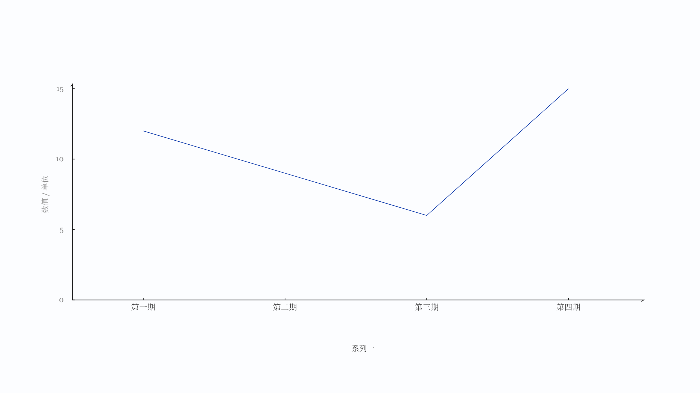

# LINE-001 折线图

## 数据形状与分级

数据形状是「带时间的序列」。分级主力，提纲时优先选它；只有在它承载不了诚实编码时才换后备，并写明理由。

## 语义

回答同一指标随时间怎样变化。点代表观测，连线代表有序变化；阶梯表示区间内保持不变。缺失就是缺失，不能当零；累计要求各项可相加，指数要求基期非零。

不能这样用。不要拿它比较不同对象的多少，那需要单系列或分组比较。不要用它表达占比构成。横轴若不是时间，等距只是视觉选择，须在来源或说明里写清口径。

## 绘制

横轴按给定的时期顺序排，等距或真实时间间距由数据口径决定。纵轴从零起，累计与指数模式按变换后的值定范围。多系列时用图例区分，位置在底部居中。

当前参考实现用 `options.shape: line/step` 控制普通/阶梯线；`options.mode: line/cumulative/index` 控制原值/累计/基期指数，不能混用。面积表达在规范内允许，但当前 `area:true` 返回 UNSUPPORTED，需按规范自绘。终点可加标注，标注不加单位。单位只在轴的标注处出现一次，形如「金额 / 万元」。

## 可调整

单系列或多系列、普通或阶梯、是否填面积、累计或指数、重点与终点标注都可换。时期数量、点距、线宽由数据与可用区域决定，不需要手调。

## 不适用规则

百分比构成不适用，这条素材没有分母。非时间横轴要显式说明，否则默认按时间口径读。时期数量按实际区域和主题字号检查容量；不足时重排或分页，不静默抽样。

## 验收

契约用例：单系列、三系列、含缺失值、不等距时期、阶梯模式。单系列与三系列要求通过；缺失值必须保留断点而不是补零；不等距时期要按真实位置落点。

## 示意图

`npm run specimen LINE-001` 重新生成，中间稿放在 build 目录，只留 PNG 在这里。示意图只画素材本身，不含标题、页码、来源。

## 当前参考接口边界

`labels` 为有序标签，`series:[{name,values}]` 等长，null 保留断点。当前横轴按标签等距，不自动解析日期；不等距时间需按真实时间重绘，不能称已自动支持。`single:true` 只在任务明确只展示首个系列时使用，不用于隐藏其他必要系列。
