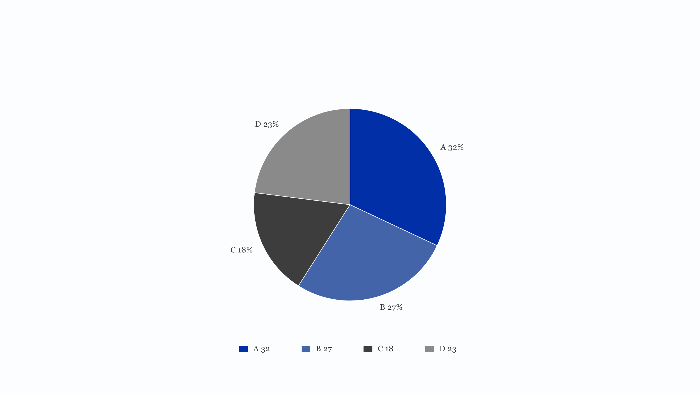

# PIE-001 占比构成

## 数据形状与分级

数据形状是「部分与整体」：一组互斥类别，各自一个非负数值，合计构成总量。分级主力，读者必须看到构成比例时用它；只是比较多少就用柱状图。

## 语义

回答总量由哪几块组成。每个扇区的角度等于该类别的数值占合计的比例。类别必须互斥，不能有重叠口径；合计为零报数据不合法。

不能这样用。不要用它比较两个不同总量内部的构成，那需要并排的两个饼或改用百分比堆叠。不要用它表达时间变化。类别超过八个不要画饼，扇区太细读不出来，改横向条形。

## 绘制

圆从十二点方向开始，顺时针按给定顺序铺扇区。半径取绘图区短边的四成，圆心在绘图区正中。扇区之间留缝，宽度取主题的 `dividerWidthPx`，靠描边实现，不靠缩角。

百分比标签放在扇区中线的六成半径处，写整数百分比，不带百分号以外的单位。占比小于 5% 的扇区不标数字，改在图例里写，避免文字压到扇区边界。

图例放在图下方居中，一项一行文字高度，符号是主题图例方块（`legendSwatchW`、`legendSwatchH`），颜色与扇区一致，文字写「类别 数值」。图例宽度不够时换行，超过两行报容量。

单位只出现一次，写在图注末尾，形如「合计：100 单位」。没有坐标轴，不画刻度，不画网格。

## 可调整

可切换环形，内半径取外半径的一半。起始角度可调。排序可按给定顺序、数值降序。标签可移到扇区外侧用引线，只在四到六类时使用。

## 不适用规则

坐标轴、刻度、网格不适用。负数不适用。零值类别直接省略，不进图例。所有类别合计为零时报错。

## 验收

逐项核对：所有百分比之和为 100（允许 ±1 的取整误差）；每个扇区角度与数值成比例，肉眼偏差要能解释；标签互不重叠、不压扇区边界；图例项数等于类别数；单位只在图注出现一次；小占比标签已按规则省略。

## 示意图

模型绘制，不进像素基线。示意图只画饼本身与图例，不含页面标题、页码。

## 样张与参考

[统一组件](../archive/占比图组件/PIE-001.html)。样张里的配色和顺序不是继承要求。
