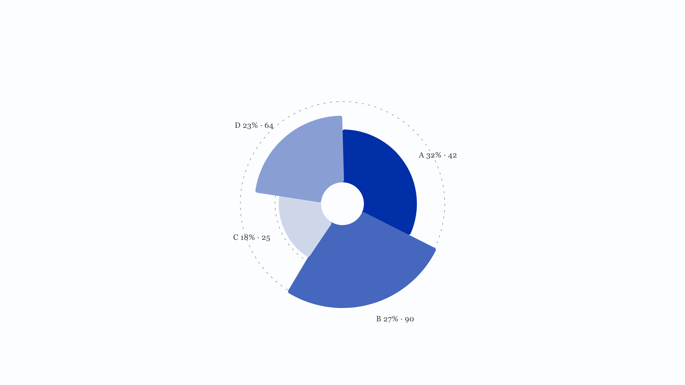

# PIE-002 双编码饼

## 数据形状与分级

数据形状是「部分与整体」加一层强度：每类给两个数，一个构成量，一个强度量。分级主力，读者既要看构成、又要看各类强弱时用它；只看构成就用 PIE-001。

## 语义

角度读构成，半径读强度。构成量决定扇瓣打开多少度，强度量决定扇瓣伸到多长。两个量必须都能解释，且强度要有同一量纲。

不能这样用。强度没有意义时不要用它，改用 PIE-001。两个量不相关或者单位不同的列之间不要共用一个半径标尺。类目超过六个不要用，扇瓣细到读不出半径差异。

## 绘制

圆心在绘图区正中偏上，外半径取主题的 `petalRadiusH`（高度比例）与 `petalRadiusW`（宽度比例）的较小值。最小半径取外半径的 `petalMinRatio`，中心留一个 `petalHolePx` 的白洞。

从十二点方向顺时针铺。每个扇瓣在最小半径与外半径之间按强度线性取值，强度最大的顶到外圈，其余按比例内缩。扇瓣之间留 `petalGapDeg` 度的缝，缝里是纸色。扇瓣角用同色描边加圆角接缝，宽度取 `petalCornerPx`。

两条虚线参考圈：外圈在外半径处，是半径标尺的上限；内圈在 `petalRingRatio` 处，标出最小半径的位置。虚线的间隔与粗细取 `petalRingDash`、`petalRingWidthPx`。

明度跟构成走，不跟强度走：占比最大的那块最深，按占比排序在主题声明的阶梯两端之间线性插值，占比越小越浅。阶梯的浅端不能取纸色，最浅的那块必须能从背景里分出来。

标签放在扇瓣外侧，沿扇瓣中线延长到半径之外一个 `labelOffsetPx` 的距离，写「类别 占比% · 强度」。不画图例，标签即图例。合计默认不写，需要时由 `center` 打开，写在中心白洞里。

## 可调整

是否标强度（关掉只留「类别 占比%」）。是否在中心写合计。扇瓣缝、最小半径比例、参考圈位置都可以在主题里调。

## 不适用规则

没有坐标轴、刻度、网格。负数不适用，构成量必须非负，强度必须为正。所有构成量合计为零时报数据不合法。不做图例，不做扇区内标签。

## 验收

逐项核对：扇瓣角度与构成量成比例；最浅的一块与纸色能分开；半径含义在标签或图注里说明；半径与强度单调一致，强度最大者顶到外圈；明度顺序与占比顺序一致；每个标签都写出占比与强度两个数；两条参考圈都在；扇瓣之间缝隙可见，缝宽一致；合计为零时报错而不是画空饼。

## 示意图

占位类别 A、B、C、D，不含页面标题、页码。半径含义写在图注，不在图内。
