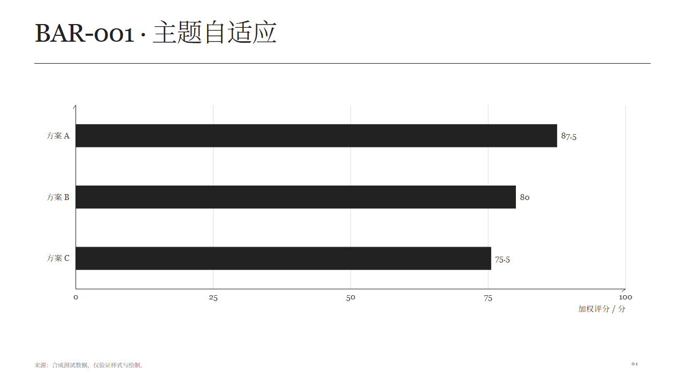
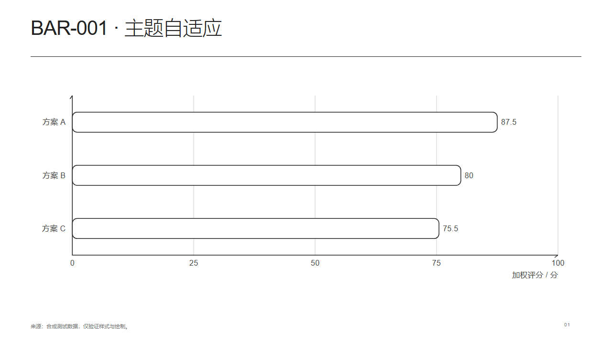

# 同一素材，三套主题

同一批实际数据、同一组目标区域，分别使用三份主题配置生成12页素材检查页。不是业务演示稿，不以铺满单素材页作为信息密度示范。每页保留来源与测试讲稿。HTML 为最终对照件，不是确认界面。

| 主题 | 页面 | 预览 |
|---|---|---|
| 黑白灰宋体、实心、直角 | [打开12页](mono.html) | [柱图](mono.png) · [流程图](mono-FLOW-001.png) |
| 克莱因蓝宋体 | [打开12页](klein-blue.html) | [柱图](klein-blue.png) · [流程图](klein-blue-FLOW-001.png) |
| 较大无衬线、轮廓、圆角 | [打开12页](rounded-mono.html) | [柱图](rounded-mono.png) · [流程图](rounded-mono-FLOW-001.png) |

GitHub显示HTML源码；下载后本地打开。字体不打包，缺字体会报告FONT。

## 验证

主题矩阵41/41通过，含36个素材主题组合和5项机制检查。另运行12项组装回归、23项参数回归、7项草稿兼容检查、31项Catalog契约与9项登记用例、基础模块及Skill格式校验。

实际读图检查了两套柱图、黑白灰流程、无衬线层级与折线、克莱因蓝环形图和无衬线表格。观察到字体字号、边界、节点形状、图例与遮线遵循当前主题；流程标签断口可见，层级标题居中，表格居中。此处是同一执行模型的自审，不是独立盲测，不证明任意长文和任意拓扑。

[主题矩阵报告](validation.json)。各主题的*-validation.json包含实际字号、字族、区域与失败列表；输入JSON可复现。运行 `node scripts/test-themes.mjs build/theming` 可重新生成，不会自动更新本目录快照。

边界：只迁移12个静态区域适配器；独立历史源件、同绘图区及动效未全量迁移。样例、输入和输出均为主题维护机制验证，不提升素材草稿状态。
